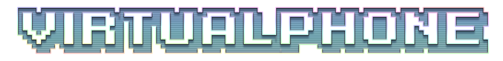

# VirtualPhone for Nintendo 3DS

VirtualPhone runs compatible Java ME phone games on Nintendo 3DS. Browse JAR and JAD files from the SD card, use the touch keypad or remap physical buttons, and choose how the phone screen fits the 3DS display. The app includes MIDI synthesis and playback of PCM WAV, mono IMA ADPCM WAV, and AMR-NB sound. Compatible Mascot Capsule Micro3D games can use the experimental 3D renderer. Compatibility varies by game and edition.

## Install

Use FBI on a homebrew-enabled 3DS to install the CIA from [Releases](https://github.com/Faefolk333/virtualphone/releases/latest). For remote installation, open **FBI → Remote Install → Scan QR Code** and scan this code.

## SD card folders

- `/3ds/virtualphone/games/` holds your own JAR and JAD files. Keep linked JAD/JAR files together.
- `/3ds/virtualphone/settings/` and `/3ds/virtualphone/saves/` hold app settings and game saves.
- `/3ds/virtualphone/modules/` holds optional compatibility modules.
- `/3ds/virtualphone/roms/symbian/` and `/3ds/virtualphone/roms/ngage/` are reserved for future support.

On first launch, VirtualPhone moves the existing `games`, `settings` and `saves` directories from `/3ds/java-3ds/` if the corresponding new directories do not exist. If both locations already contain data, the app preserves both copies.

Wi-Fi updates are available from the library's **Y** menu. Install over the previous title to keep the same app identity.

## 3D games and the optional M3G module

JSR-184, also called Mobile 3D Graphics (M3G), is a Java ME 3D API. For games that require it, place a legally obtained **VirtualPhone-compatible JSR-184/M3G implementation** at **`/3ds/virtualphone/modules/m3g.jar`**, then reopen the library. This must be an implementation with the `javax.microedition.m3g` classes and compatibility with VirtualPhone's Java renderer. A specification, a game JAR, or a generic desktop Java 3D library will not work as the module. This project does not currently distribute a public compatible module.

Examples verified by inspecting the listed JAR editions:

| Game edition | 3D API |
| --- | --- |
| Colin McRae DiRT (320 × 240, `colin_mcrae_dirt_2d_320x240_187848.jar`) | JSR-184 / M3G |
| Gladiator 3D (240 × 320, Nokia 6280/5300) | JSR-184 / M3G |
| Snowboard Hero 3D (320 × 240) | JSR-184 / M3G |
| Blades and Magic (tested 320 × 240 and Sony Ericsson 240 × 320 editions) | Mascot Capsule Micro3D |
| Devil May Cry 3D (Player X) | Mascot Capsule Micro3D |

Other editions may use different APIs. Mascot Capsule Micro3D support is built in and experimental.

## Roadmap and notices

Symbian and N-Gage support is in development for a later update. Add your own JAR and JAD files to play. See the [third-party notices](THIRD-PARTY-NOTICES.txt).
